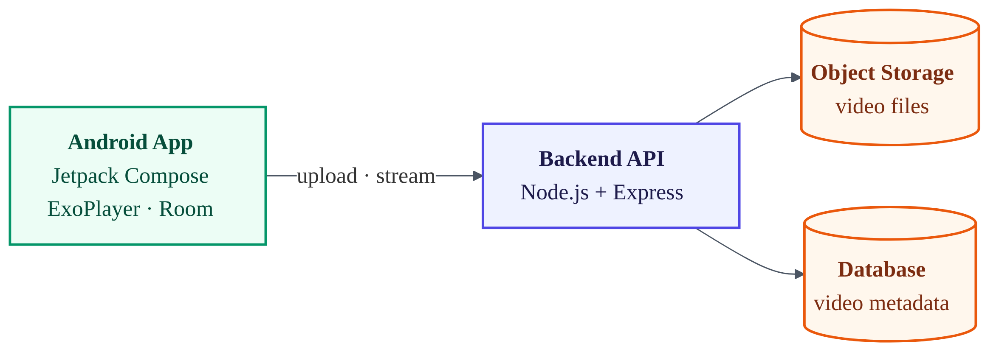
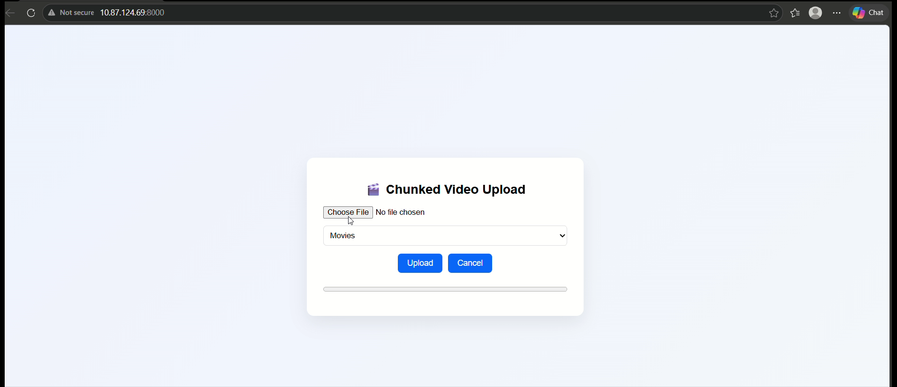
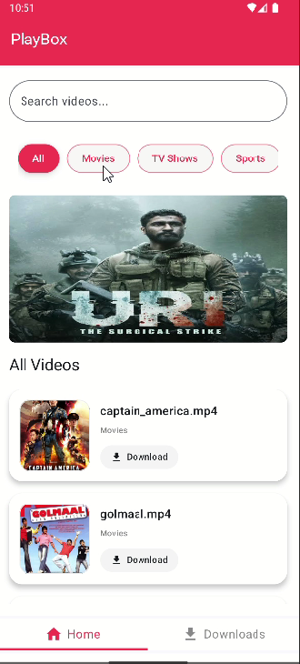
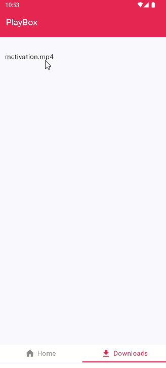

# 🎬 PlayBox2

A video streaming app for Android with a cloud backend.

## ❗ Problem

Streaming apps need videos to stay available, load fast and be easy to upload, even when the server restarts or the files are large.

## ✅ Solution

- A stateless backend, so restarting it never loses data
- Videos and metadata stored outside the server
- Large videos uploaded in chunks
- Playback that fetches only the part of the video being watched, so it starts fast and seeking works

## ⚡ Features

- Category tabs
- Smooth playback with seeking
- Offline caching and downloads
- Chunked upload

## 🏗️ Architecture

<p align="center">
  
</p>

## 🛠️ Tech Stack

| Part | Technology |
|---|---|
| App | Kotlin, Jetpack Compose, ExoPlayer, Room, WorkManager, Retrofit |
| Backend | Node.js, Express |
| Storage | Cloud object storage and MongoDB |

## 📸 Demo

<p align="center">
  
</p>

<p>
   <br> 
  
  
</p>

▶️ Full video: https://youtu.be/00FonEQys88

## 💻 Run the app

1. Clone the repo:
   ```bash
   git clone https://github.com/curiousfalak/PlayBox2.git
   ```
2. Open it in Android Studio.
3. Build and run.

## 👨‍💻 Author

**Falak Khan**
[GitHub](https://github.com/curiousfalak) · [LinkedIn](https://www.linkedin.com/in/falak-khan-636188296/)
